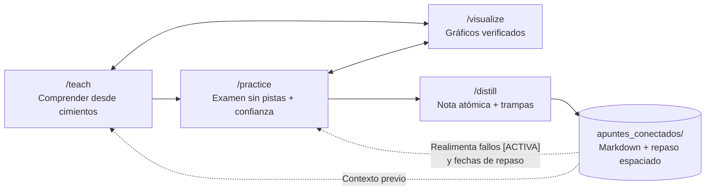

# Study Skills — Sistema de aprendizaje en bucle cerrado para agentes de IA

Conjunto de cuatro *skills* (`teach`, `visualize`, `practice` y `distill`) en formato estándar `SKILL.md` para estudiar asignaturas técnicas y de ingeniería sobre tus propios PDFs, diapositivas y código, sin caer en el estudio pasivo ni en la ilusión de competencia.

Funciona con **cualquier agente de código/terminal que soporte *skills*** — como **Antigravity**, **Claude Code**, **Gemini CLI**, **Codex** o **Cursor**. No requiere aplicaciones externas: todo corre sobre archivos Markdown locales dentro de la carpeta de cada asignatura (y las notas son opcionalmente compatibles con Obsidian si quieres explorar el grafo).



---

## Qué incluye cada skill

| Skill | Archivo | Objetivo | Mecánica clave |
| :--- | :--- | :--- | :--- |
| **`/teach`** | [`skills/teach/SKILL.md`](skills/teach/SKILL.md) | Entender un tema o duda desde fundamentos sin memorizar fórmulas sueltas. | Sondeo por búsqueda binaria (*Probe → Plan → Teach*), mapa de dependencias en Mermaid, verdades incondicionales primero y derivación motivada paso a paso. |
| **`/visualize`** | [`skills/visualize/SKILL.md`](skills/visualize/SKILL.md) | Generar gráficas matemáticas, esquemas o diagramas que aclaren geometría o comportamiento. | Python (`matplotlib`), SVG o Mermaid guardados en `graficos/`, con bucle obligatorio de **renderizar → inspeccionar visualmente → corregir** antes de entregar nada. |
| **`/practice`** | [`skills/practice/SKILL.md`](skills/practice/SKILL.md) | Entrenar a nivel de examen real, eligiendo herramientas sin pistas de tema. | 1 pregunta por turno, 5 arquetipos (*Transferencia, Discriminación, Diagnóstico, Síntesis, Contrafactual*), test sin pistas asimétricas, calibración de confianza (*hypercorrection*) y modo mini-simulacro o código con tests. |
| **`/distill`** | [`skills/distill/SKILL.md`](skills/distill/SKILL.md) | Comprimir lo aprendido en una nota corta que puedas repasar en 3 minutos. | Mini-explicación Feynman de 30 s antes de guardar, nota Markdown en `apuntes_conectados/` con frontmatter YAML para repetición espaciada, `[[wikilinks]]` (compatible con Obsidian) y registro `[ACTIVA]` / `[SUPERADA]` de tus fallos reales. |

---

## Por qué está diseñado así

Usar un LLM por defecto para estudiar suele fallar en cuatro puntos concretos que estas *skills* corrigen de forma explícita:

1. **Explicaciones que asumen nivel equivocado:** `/teach` acota tu frontera real antes de explicar (un suelo que dominas y un techo donde se rompe) y presenta un mapa de dependencias antes de arrancar.
2. **Preguntas tipo test que regalan la respuesta:** tanto `/teach` como `/practice` prohíben justificaciones dentro de las opciones (*"..., porque..."*), longitudes desiguales o negritas asimétricas; los distractores se construyen mutando la respuesta correcta con errores reales.
3. **Gráficos rotos o ilegibles:** `/visualize` obliga al agente a abrir y auditar la imagen PNG renderizada para comprobar signos, ejes y solapamientos de texto antes de enseñártela.
4. **Olvido entre sesiones:** `/distill` guarda cada tema en `apuntes_conectados/` con fecha `proximo_repaso` y etiqueta tus fallos de alta confianza. Cuando vuelves a abrir `/practice` días después, el agente lee esa carpeta en silencio y te lanza repaso espaciado sin avisar de qué tema viene.

> **Nota sobre uso por voz:** las *skills* están preparadas para razonar en voz alta (por ejemplo con dictado `Windows + H` en Windows): el agente ignora erratas de transcripción o puntuación y audita únicamente tu cadena lógica.

---

## Cómo usarlo en una asignatura

### 1. Estructura de trabajo
Abre tu agente dentro de la carpeta donde tienes los apuntes, PDFs o código de la asignatura. Al usar el sistema, el agente creará únicamente las carpetas necesarias junto a tu material:

```text
mi-asignatura/
├── tema1_diapositivas.pdf
├── apuntes_conectados/        # Notas atómicas Markdown creadas por /distill (opcionalmente abrible en Obsidian)
│   └── cinematica-robot-diferencial.md
├── graficos/                  # Gráficas y esquemas verificados por /visualize
│   └── robot-diferencial-icr.png
└── practica_codigo/           # Ejercicios y tests creados por /practice en modo programación
```

### 2. Flujo típico de una sesión

1. **Estudiar un tema o resolver una duda:**
   ```text
   /teach Quiero entender el Tema 3 a partir de tema3.pdf
   ```
   *(Para una duda puntual de 3 minutos basta con preguntar directo, ej. `/teach no entiendo por qué cambia este signo en la diapositiva 12`, y se activa el modo Duda Quirúrgica sin plan largo).*

2. **Pedir un esquema o gráfica (también se activa solo desde `/teach` y `/practice`):**
   ```text
   /visualize Dibuja el centro instantáneo de rotación (ICR) de un robot diferencial para w_R > w_L
   ```

3. **Ponerte a prueba antes del examen:**
   ```text
   /practice Hazme preguntas tipo test intercaladas de los temas 1 al 3, en el examen dejan diapositivas delante
   ```
   O en formato examen sin corrección intermedia:
   ```text
   /practice Modo simulacro: 5 preguntas seguidas de toda la asignatura
   ```

4. **Cerrar la sesión consolidando lo aprendido:**
   ```text
   /distill
   ```
   El agente te pedirá resumir en 30 segundos qué te llevas y dónde dudaste, y actualizará tu nota en `apuntes_conectados/`. Puedes ver un ejemplo completo en [`examples/cinematica-robot-diferencial.md`](examples/cinematica-robot-diferencial.md).

---

## Instalación (compatible con cualquier agente)

Las *skills* siguen el formato estándar de carpetas con `SKILL.md`, así que solo tienes que copiar el contenido de `skills/` a la ruta de *skills* de tu agente:

```bash
git clone https://github.com/chema282/study-skills.git
```

### Claude Code
Puedes instalarlas de forma **global** (para todas tus carpetas) o solo en una asignatura concreta (`.claude/skills/`):

**Linux / macOS:**
```bash
mkdir -p ~/.claude/skills
cp -r study-skills/skills/* ~/.claude/skills/
```

**Windows (PowerShell):**
```powershell
New-Item -ItemType Directory -Force "$env:USERPROFILE\.claude\skills" | Out-Null
Copy-Item -Path .\study-skills\skills\* -Destination "$env:USERPROFILE\.claude\skills\" -Recurse -Force
```

Una vez copiadas, en Claude Code se invocan directamente como `/teach`, `/visualize`, `/practice` y `/distill`.

### Antigravity / Gemini CLI
**Windows (PowerShell):**
```powershell
New-Item -ItemType Directory -Force "$env:USERPROFILE\.gemini\config\skills" | Out-Null
Copy-Item -Path .\study-skills\skills\* -Destination "$env:USERPROFILE\.gemini\config\skills\" -Recurse -Force
```

**Linux / macOS:**
```bash
mkdir -p ~/.gemini/config/skills
cp -r study-skills/skills/* ~/.gemini/config/skills/
```

### Codex, Cursor u otros agentes
- **Codex / agentes compatibles con Agent Skills:** copia las carpetas de `skills/` en `.agents/skills/` (proyecto) o `~/.agents/skills/` (global).
- **Cursor / otros entornos:** copia los archivos `SKILL.md` como reglas/comandos de usuario o referéncialos en tu archivo de instrucciones.

### Extras opcionales

- **Python 3** con `matplotlib`, `numpy` y `pymupdf` (`pip install matplotlib numpy pymupdf`): recomendado para que `/visualize` genere gráficas limpias y para que `/teach` / `/practice` puedan renderizar páginas de PDFs con fórmulas o diagramas cuando el texto plano no basta.
- **Obsidian** *(totalmente opcional)*: no hace falta instalarlo para que el sistema funcione; todo se lee y guarda como Markdown normal. Si más adelante quieres visualizar el grafo de `[[wikilinks]]` o repasar las notas con renderizado bonito de LaTeX y Mermaid, basta con abrir `apuntes_conectados/` como un *vault* en Obsidian.

---

## Licencia

Distribuido bajo licencia [MIT](LICENSE). Puedes adaptar las *skills* libremente a tu grado, idioma o flujo de estudio.
