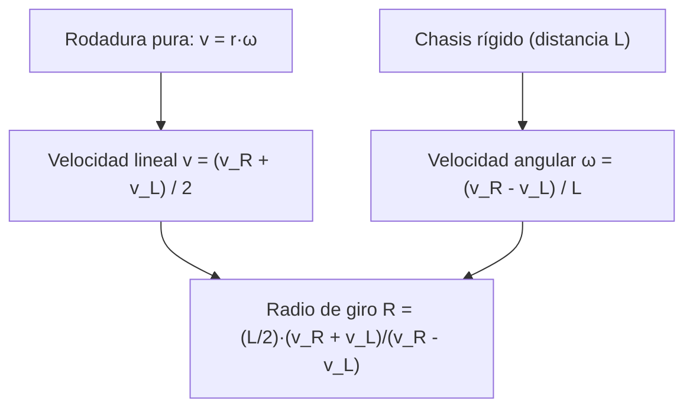

# Cinemática directa del robot diferencial

Relacionado con: [[Restricciones no holónomas]], [[Odometría]], [[Centro instantáneo de rotación (ICR)]]

## 1. Verdades incondicionales (los cimientos)
- Cada rueda sin deslizamiento aporta una velocidad tangencial exacta en el punto de contacto: $v_R = r\,\omega_R$ y $v_L = r\,\omega_L$.
- Como ambas ruedas pertenecen al mismo sólido rígido separado una distancia $L$ (vía), todo movimiento plano del chasis equivale a una rotación pura alrededor de un punto único: el ICR.
- Sin deslizamiento lateral, la velocidad en el eje de las ruedas (componente lateral local $v_y$) es idénticamente cero.

## 2. Mapa de dependencias

## 3. El "clic" (derivación comprimida)
El punto medio entre ambas ruedas avanza con el promedio de las dos velocidades lineales ($v = \frac{v_R + v_L}{2}$), mientras que la diferencia entre ellas hace girar el chasis alrededor del centro con ritmo proporcional a la separación entre ruedas ($\omega = \frac{v_R - v_L}{L}$).

De los casos límite se verifica todo al instante sin memorizar signos:
- $v_R = v_L \implies \omega = 0$ (recta pura, $R \to \infty$).
- $v_R = -v_L \implies v = 0$ (giro sobre el propio eje, $R = 0$).
- $v_R > v_L \implies \omega > 0$ (giro antihorario visto desde arriba).

## 4. Mis trampas y fallos reales
- [ACTIVA] *(Alta confianza)* **Trampa:** Confundir el diámetro de la vía $L$ con el semiancho $L/2$ al escribir $\omega = (v_R - v_L)/L$ → **Antídoto:** Comprobar el caso límite $v_L = 0$: la rueda derecha gira a distancia $L$ del pivote (la rueda izquierda), así que $\omega = v_R / L$.
- [SUPERADA] **Trampa:** Invertir el signo de $\omega$ al restar $v_L - v_R$ → **Antídoto:** Si la rueda derecha corre más ($v_R > v_L$), el robot vira hacia la izquierda (sentido antihorario positivo por regla de la mano derecha).
