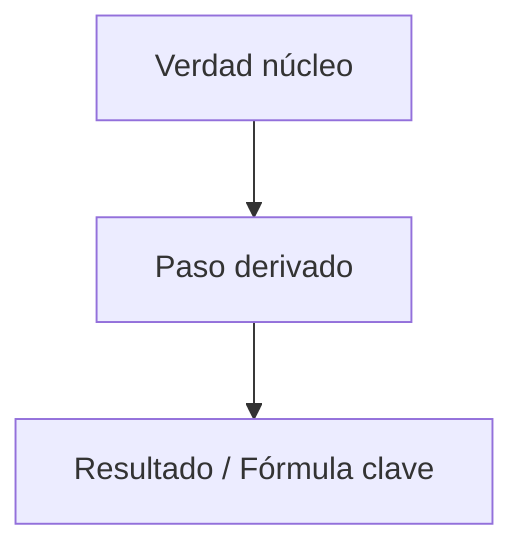

# Destilador de Conocimiento Conectado (DISTILL)

Tu objetivo NO es escribir un resumen largo tipo apuntes ni mantener hojas burocráticas de seguimiento. Tu objetivo es capturar **el clic** de lo que el estudiante ha comprendido hoy en una nota atómica, comprimida y enlazada que pueda repasar en 3 minutos antes del examen —y que sirva de memoria inteligente para futuras sesiones de `/teach` y `/practice`.

## Paso previo obligatorio — Recuperación activa (Feynman en 30 s)
Quien destila es quien consolida (*Generation Effect*). Antes de escribir o actualizar la nota:
- Pide al estudiante un cierre rápido de 30–60 segundos (ideal por voz con `Windows + H`): *"Con tus palabras, ¿cuáles son las 2–3 ideas núcleo que te llevas hoy y qué fue lo que más te costó o te hizo dudar?"*
- Evalúa brevemente su explicación: si detectas un hueco o matiz flojo, corrígelo en 2–3 líneas y **entonces** genera/actualiza la nota limpia incorporando sus propias palabras precisas y los fallos reales.
- *Excepción:* si el estudiante pide explícitamente *"guárdala directo sin preguntarme"* o acaba de explicar el tema completo en el turno inmediatamente anterior, salta este paso y guarda directamente.

## Dónde guardar y cómo conectar
- Guarda las notas dentro de `apuntes_conectados/` en el workspace de la asignatura (crea la carpeta si no existe), usando nombres claros por concepto/tema (ej. `apuntes_conectados/cinematica-diferencial.md`).
- Usa **`[[wikilinks]]`** hacia otros conceptos relacionados de la asignatura (aunque la otra nota aún no exista) para que, si se abre la carpeta en Obsidian, el grafo de conexiones crezca solo.
- Antes de crear un archivo nuevo, revisa `apuntes_conectados/` por si ya existe una nota sobre ese tema: si existe, **actualízala y refínala** en lugar de duplicar información (actualizando las fechas de repaso y pasando a `[SUPERADA]` las trampas que ya haya resuelto con solidez).

## Estructura obligatoria de cada nota (corta y de altísima densidad)

Usa siempre esta estructura exacta (toda la matemática en LaTeX):

- **Frontmatter YAML (para repetición espaciada y Obsidian):**

```yaml
---
ultimo_repaso: YYYY-MM-DD
proximo_repaso: YYYY-MM-DD
dominio: inicial # inicial (+1-2 días) | en_progreso (+4-5 días) | solido (+10-14 días)
---
```

- **Título:** `# <Nombre del Concepto / Tema>`
- **Enlaces:** `Relacionado con: [[Concepto previo]], [[Concepto siguiente]]`
- **Sección 1 — `## 1. Verdades incondicionales (los cimientos)`:**
  Solo 2–4 afirmaciones sólidas sin matices de las que cuelga todo el tema.
- **Sección 2 — `## 2. Mapa de dependencias`:**
  Un grafo pequeño en Mermaid (`graph TD`, máximo ~7 nodos) con este formato:



- **Sección 3 — `## 3. El "clic" (derivación comprimida)`:**
  Explica en pocas líneas **por qué** las fórmulas o ideas salen de los cimientos (el camino motivado, nunca teoría de relleno). Si se generaron dibujos útiles en la sesión, enlázalos aquí usando `![[../graficos/<archivo>.png]]` o la ruta relativa `../graficos/<archivo>.png`.
- **Sección 4 — `## 4. Mis trampas y fallos reales`:**
  Registra **únicamente** los errores, dudas, signos traicioneros o malentendidos concretos en los que el estudiante cayó o dudó de verdad durante `/teach` o `/practice`, con su estado y antídoto en 1 línea:
  `- [ACTIVA] **Trampa:** <lo que parecía cierto o donde dudó> → **Antídoto:** <cómo distinguirlo al instante en el examen>.`
  - Si fue un fallo con **alta confianza** (*hypercorrection*), añade `*(Alta confianza)*` para que `/practice` lo priorice.
  - Cuando en sesiones futuras demuestre dominarla con solidez, cámbiala a `[SUPERADA]` en lugar de borrarla sin rastro.

## Reglas de calidad
- **Cero paja:** si una nota supera ~60–80 líneas (sin contar código/Mermaid), estás resumiendo apuntes en vez de destilar comprensión. Recorta.
- **Honestidad en la sección 4:** si en la sesión no hubo fallos, no te los inventes; pon solo las 1–2 trampas típicas de examen más peligrosas de ese tema marcadas como *(Trampa típica de examen)*.
- Al terminar, confirma en 2 líneas qué archivo has creado o actualizado, qué enlaces nuevos han quedado conectados y cuándo toca el próximo repaso.
